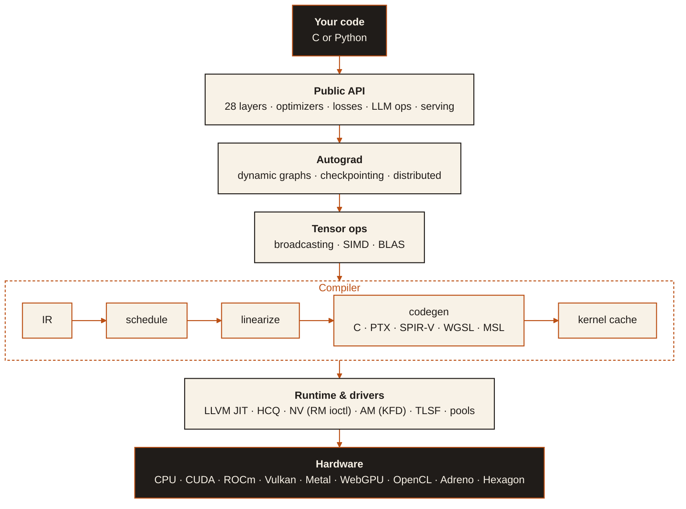

<p align="center">
  <picture>
    <source media="(prefers-color-scheme: dark)" srcset="docs/cml-banner-dark.svg">
    <source media="(prefers-color-scheme: light)" srcset="docs/cml-banner-light.svg">
    
  </picture>
</p>

<p align="center">
  <a href="https://github.com/jaywyawhare/C-ML/actions/workflows/ci.yml"></a>
  <a href="https://github.com/jaywyawhare/C-ML/actions/workflows/fuzz.yml"></a>
  <a href="https://github.com/jaywyawhare/C-ML/actions/workflows/wheels.yml"></a>
  <a href="https://github.com/jaywyawhare/C-ML/actions/workflows/deploy-website.yml"></a>
</p>

<p align="center">
  <a href="https://github.com/jaywyawhare/C-ML/releases"></a>
  
  <a href="python/README.md"></a>
  
  
  <a href="LICENSE.md"></a>
  <a href="https://github.com/jaywyawhare/C-ML/stargazers"></a>
  <a href="https://github.com/jaywyawhare/C-ML/commits/master"></a>
</p>

<p align="center">
  <a href="https://jaywyawhare.github.io/C-ML/"><b>Website</b></a> ·
  <a href="docs/getting_started.md"><b>Getting started</b></a> ·
  <a href="docs/api_reference.md"><b>API reference</b></a> ·
  <a href="python/README.md"><b>Python</b></a> ·
  <a href="examples/README.md"><b>Examples</b></a> ·
  <a href="https://github.com/jaywyawhare/C-ML/releases"><b>Releases</b></a>
</p>

C-ML is a machine learning library written from scratch in C11. It covers
tensors, autograd, 28 layers and the optimizers to train them, a compiler that
fuses ops and emits GPU kernels (PTX, SPIR-V, WGSL, MSL), distributed training,
LLM inference, and model I/O for GGUF, ONNX and SafeTensors. It has no required
dependencies.

## Quick start

Build the library, tests and examples:

```bash
git clone https://github.com/jaywyawhare/C-ML.git
cd C-ML && mkdir -p build && cd build
cmake -DBUILD_EXAMPLES=ON -DBUILD_TESTS=ON .. && make -j$(nproc)
```

Fit `y = 2x + 1` with one linear layer:

```c
#include "cml.h"
#include <stdio.h>

int main(void) {
    cml_init();

    float xs[8], ys[8];
    for (int i = 0; i < 8; i++) {
        xs[i] = i / 7.0f;
        ys[i] = 2.0f * xs[i] + 1.0f;
    }
    Tensor* x = cml_tensor_2d(xs, 8, 1);
    Tensor* y = cml_tensor_2d(ys, 8, 1);

    Module* model = (Module*)cml_nn_linear(1, 1, DTYPE_FLOAT32, DEVICE_CPU, true);
    Optimizer* opt = cml_optim_sgd_for_model(model, 0.1f, 0.0f, 0.0f);

    for (int step = 1; step <= 200; step++) {
        cml_optim_zero_grad(opt);
        Tensor* loss = cml_nn_mse_loss(cml_nn_module_forward(model, x), y);
        cml_backward(loss, NULL, false, false);
        cml_optim_step(opt);
        if (step % 50 == 0)
            printf("step %d  loss %.5f\n", step, tensor_get_float(loss, 0));
        tensor_free(loss);
    }

    cml_cleanup();
    return 0;
}
```

The [examples guide](docs/examples.md) has 17 more tutorials, from XOR and linear regression to RNNs, GANs and a Transformer encoder.

### Python

```bash
cd python && pip install cffi && python3 cml/build_cffi.py && pip install -e .
python3 -c "import cml; cml.init(); print('ok'); cml.cleanup()"
```

See the [Python guide](python/README.md) for the PyTorch-style API.

## Features

| Area | What's included |
|:--|:--|
| **Layers** | 28 layers: Linear, Conv1d/2d/3d, ConvTranspose, RNN, LSTM, GRU, Transformer, BatchNorm, LayerNorm, RMSNorm, pooling, Dropout, PixelShuffle |
| **Training** | 11 optimizers · 13 losses · 8 LR schedulers · gradient checkpointing · DDP · pipeline and tensor parallelism |
| **LLMs** | LLaMA 7B–70B · LoRA / QLoRA · Flash Attention · GQA · ALiBi · RoPE scaling · paged and sliding-window KV cache · MoE · ring attention · speculative decoding · continuous-batching server |
| **Compiler** | IR with 5 fusion patterns · linearization · codegen to C, PTX, SPIR-V, WGSL and MSL · AOT and JIT · kernel cache |
| **Runtime** | LLVM JIT with shape-specialized SIMD and an interpreter fallback · f32, f64, f16, bf16 and int dtypes · BLAS · TLSF allocator · memory and thread pools |
| **Model I/O** | GGUF · SafeTensors · ONNX · PyTorch checkpoints · int8, int4 and NF4 quantization |
| **Python** | CFFI bindings · NumPy interop · operator overloading |

## Backend status

CI runs every GPU path through the CPU reference backend, mocks and emulators.
Driver calls are only proven correct on real hardware, so the GPU backends are
marked accordingly. Status as of 2026-08:

| Backend | Status | What that means |
|:--|:--|:--|
| CPU: SIMD, BLAS, LLVM JIT | **Stable** | Default backend; the full test suite runs on it |
| HCQ queues, signals, pipelines | **Stable** | Same dispatch path for every backend, tested on the CPU reference |
| CUDA, ROCm, OpenCL, Vulkan, WebGPU | **Build-verified** | Compile everywhere, load at runtime and fail cleanly without hardware; not yet validated on a GPU |
| NV (RM ioctl), AMD (KFD) drivers | **Experimental** | Covered by mock tests; real ioctl paths need hardware |
| Multi-GPU: peer copy, device placement | **Simulated** | Runs on the device simulator only |
| Adreno, Hexagon, Thunder, USB | **Placeholder** | Stub or generic kernels; not for production |

## Architecture



## Documentation

| Topic | Guides |
|:--|:--|
| **Start here** | [Getting started](docs/getting_started.md) · [API reference](docs/api_reference.md) · [Examples](docs/examples.md) · [Python bindings](docs/python_installation.md) |
| **Models** | [NN layers](docs/nn_layers.md) · [Advanced NN and LLMs](docs/advanced_nn.md) · [Speculative decoding](docs/speculative_decoding.md) · [BEAM search](docs/beam_search.md) |
| **Training** | [Training](docs/training.md) · [Autograd](docs/autograd.md) · [Datasets](docs/datasets.md) · [Distributed training](docs/distributed.md) |
| **Compiler** | [Compiler pipeline](docs/compiler_pipeline.md) · [IR graph management](docs/ir_graph_management.md) · [Graph mode](docs/graph_mode.md) · [Linearization](docs/linearization.md) · [Optimizations](docs/optimizations.md) |
| **Runtime** | [GPU backends](docs/gpu_backends.md) · [Memory management](docs/memory_management.md) · [Kernel Studio](docs/kernel_studio.md) ([quick reference](docs/kernel_studio_quickref.md)) |
| **Reference** | [Model I/O](docs/model_io.md) · [Benchmarks](docs/benchmarks.md) · [External dependencies](docs/EXTERNAL_DEPENDENCIES.md) · [Miscellaneous](docs/miscellaneous.md) · [All docs](docs/index.md) |

## License

[DBaJ-NC-CFL](LICENSE.md), the "Don't Be a Jerk" non-commercial license.
